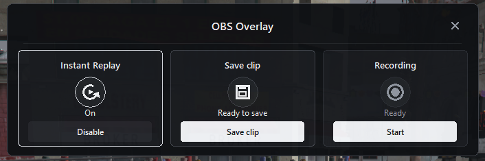

# OBS Overlay

A modern, Shadowplay-style Overlay for OBS Studio.

## Features

### Design
- **Modern dark design**
  - Semi-transparent overlay (adjustable), subtle borders, rounded corners
  - White accent color, clean typography (Segoe UI), no window frame
  - Freely draggable, always on top while open
  - Active tiles are highlighted (bright border and icon)
- **Color-coded indicators**
  - Red: recording in progress
  - Yellow: recording paused, warnings
  - White: active / success (e.g. clip saved)

### Controls
- **Alt + Z** opens/closes the overlay, **Esc** closes it (hotkey can be rebound in OBS)
- Three tiles: **Replay Buffer**, **Save clip**, **Recording**
- Every button calls the real OBS functions directly

### Status indicators
- Small, click-through indicators in the bottom-right corner, visible even when the overlay is closed
  - Replay Buffer: icon only, shown while the buffer is active
  - Recording: pulsing red dot with elapsed time (yellow when paused)
- Short action notifications in the top-right corner (3 seconds, no animation, click-through):
  - Recording started / stopped / paused / resumed
  - Replay Buffer enabled / disabled
  - Clip saved (with file name)
- Reacts to OBS events, so it also works when actions are triggered via OBS hotkeys or the OBS interface

### Reliability
- State comes from OBS events, not from button clicks; a once-per-second check catches missed events
- Protection against repeated clicks, no duplicate windows or hotkeys
- Tkinter runs in its own thread, OBS actions run separately from it (thread-safe)
- Clean shutdown when OBS closes or the script is unloaded
- Lightweight: Python standard library only, no extra packages
- German and English (picked automatically from the Windows language)

## Installation

1. Download the python-3.6.8-embed-amd64.rar that includes a Python compatible package with the necessary libraries.
2. Open OBS and go to Tools > Scripts
3. Configure the Python installation path by selecting the extracted folder
4. Go to Scripts tab, click the "+" button and add "obs_shadowplay_overlay.py
5. Restart OBS Studio

## Requirements

- OBS Studio 33.0 or newer
- Python 3.6.8 with Tkinter support

## Preview

## Notes

- If you encounter any issues, restart OBS and check the script console
- The notification appears in the top-right corner by default
- Tested on Windows 10

## Support

Discord: Vin4tage